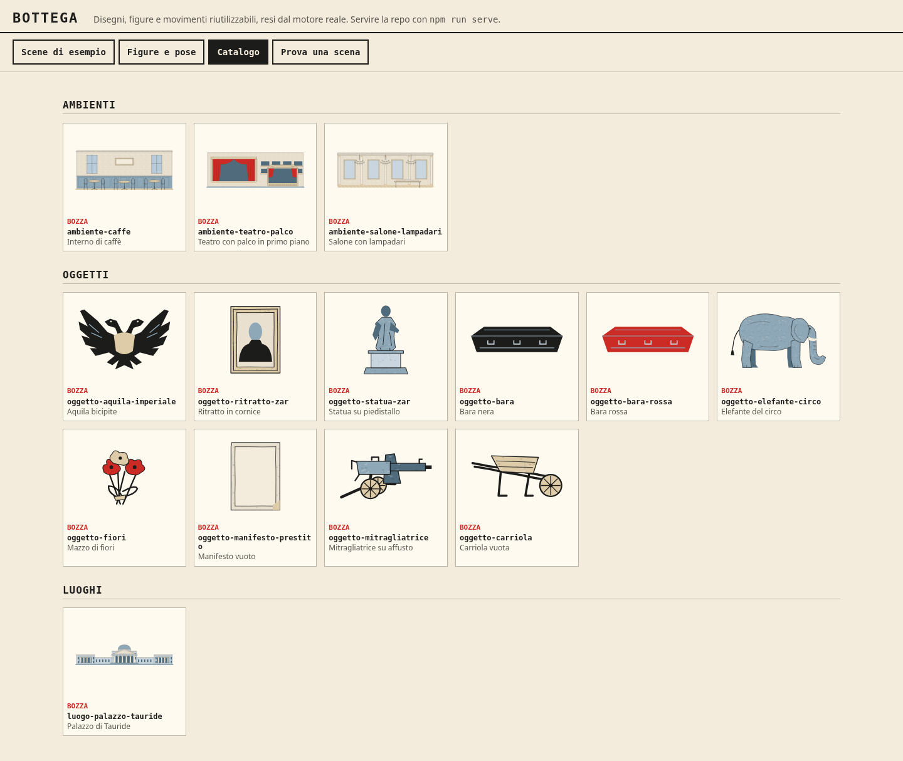
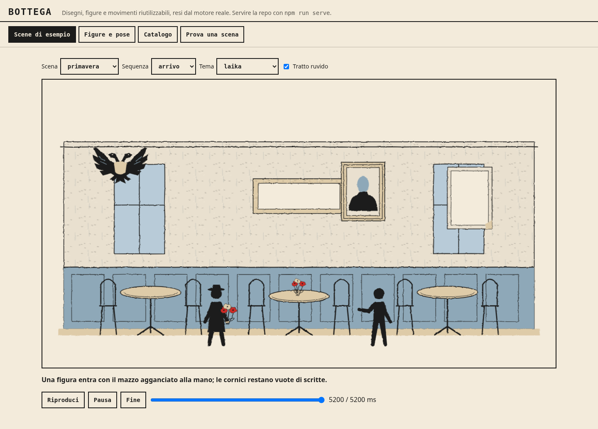
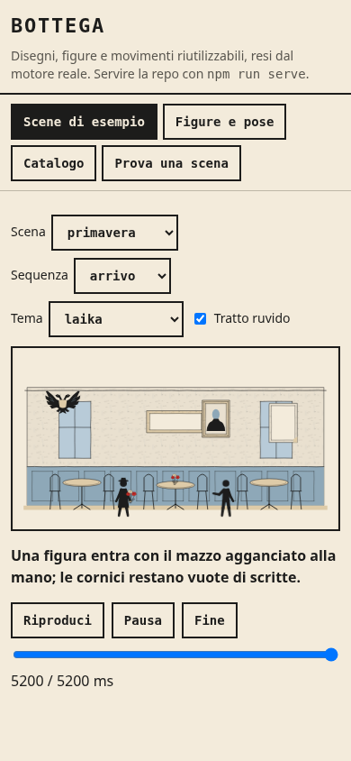

# Oggetti e ambienti per l'Atto II

Base del ramo: `1c606f8`. Ramo: `feat/atto-ii-asset`. La compatibilità con il successivo `main` a `2c50829`, che aggiunge l'unità I.2, è verificata applicando la patch in un worktree isolato.

La consegna aggiunge 14 simboli: nove oggetti con una seconda variante della bara, tre ambienti e il Palazzo di Tauride. Tutte le nuove voci sono in stato `bozza`. Epoca, provenienza, scala delle figure e dettagli da rivedere sono nelle singole voci di `bottega/catalogo.json`.

Gli originali già presenti in `prototypes/` e `references/` restano intatti. Il nuovo kit autonomo è `prototypes/kit-primavera-1917/kit-primavera-1917.html`. La produzione usa i layer a token rigenerati con l'importatore. Il motivo di grana coincide esattamente con quello degli ambienti esistenti: viene riusato come `grana-ambienti`. L'importatore ammette il riuso solo se geometria e colori coincidono; rifiuta due definizioni diverse con lo stesso nome. Non ci sono modifiche proposte ai pacchetti generati del corso e della home.

## Prova riproducibile

```sh
npm test
npm run bottega:importa
npm run bottega:verifica
npm run scena -- bottega/esempi/primavera.json
npm run build:laika
npm run build:home -- site/laika
python3 scripts/build-motion-preview.py
python3 scripts/build-motion-preview.py --rig
npm run test:browser
npm run serve
```

Aprire `http://localhost:4173/bottega/galleria.html`, scegliere la scena `primavera` e premere Fine. Il tema predefinito è `laika`; il controllo Tema permette anche il confronto con `studi`, `laika-grigio` e `neutro`. La scena è una tavola tecnica e non ricostruisce un evento: usa cinque nuovi simboli e una figura con `oggetti: ["fiori"]`.

Il prop `fiori` usa `hand-near`, con presa nella legatura e stesso markup del mazzo autonomo. I test controllano anche la composizione in più pose e temi. Le varianti `oggetto-bara` (nera) e `oggetto-bara-rossa` hanno geometria, ingombro e appoggio identici.

## Risultati eseguiti

- `npm test` sulla base aggiornata: 97 test superati prima delle modifiche.
- `npm test` sulla versione finale del ramo: 103 test superati.
- `npm test` sulla patch applicata al nuovo `main` a `2c50829`: 104 test superati, incluso il nuovo test dell'unità I.2.
- `node --test tests/atto2-assets.test.js`: sei controlli mirati superati.
- `npm run bottega:importa` e `npm run bottega:verifica`: 118 simboli aggiornati.
- `npm run scena -- bottega/esempi/primavera.json`: 165 layer; sequenze `arrivo` con 10 tracce e `osserva` con 6 tracce.
- Verifica browser mirata `tests/browser-bottega.cjs`: 163 confronti al pixel a zero differenze e 11 scene di esempio superate.
- Galleria Chromium 154.0.8037.57 con Playwright 1.58.2: screenshot desktop 1440 × 1000 e mobile 390 × 844, controllo reduced motion, nessun errore JavaScript e nessuno scorrimento orizzontale a 390 px.
- `PLAYWRIGHT_BROWSERS_PATH=/tmp/laika-atto2-browsers npm run test:browser`: suite Chromium completa superata con Chromium 145.0.7632.6 e Playwright 1.58.2. Include giochi dimostrativi, home, contratti pubblici, motion, LAIKA, gestione I.1, rig e bottega.
- `KIT_BROWSER=webkit PLAYWRIGHT_BROWSERS_PATH=/tmp/laika-atto2-browsers LD_LIBRARY_PATH=/tmp/laika-atto2-webkit-libs/usr/lib/x86_64-linux-gnu PLAYWRIGHT_SKIP_VALIDATE_HOST_REQUIREMENTS=1 npm run test:browser`: suite WebKit 26.0 completa superata, inclusi 163 confronti al pixel a zero differenze e 11 scene di esempio.

Le due suite complete sono state ripetute con la patch finale nel worktree `/tmp/laika-atto2-integrazione`, basato su `2c50829`: entrambe superate. Il worktree è stato creato con `git worktree add --detach` e la patch applicata con `git apply`, senza merge o riscrittura della storia del ramo. La nuova unità I.2 è così inclusa nelle regressioni.

Playwright 1.58.2 e i suoi browser sono stati installati con cache in `/tmp`. Le librerie WebKit mancanti sono state scaricate come pacchetti Debian ed estratte soltanto in `/tmp`, poi collegate nella directory `sys/lib` del browser scaricato. Il caricamento delle sette librerie richieste e le dipendenze del binario sono stati verificati prima di avviare WebKit. Il controllo preliminare di Playwright basato su `ldconfig` non vede `libGLESv2` fuori dalla cache di sistema: per questo è stata usata la variabile indicata sopra. Non è stata fatta un'installazione di sistema.

Sul laboratorio motion già presente la misura di pacing finale è stata: Chromium mediana 16,7 ms, p95 16,8 ms; WebKit mediana 22 ms, p95 55 ms con 48 frame oltre 50 ms. Sono misure sulla macchina cloud, non su un telefono. I test funzionali passano; questa misura non certifica 60 fps su dispositivi reali. La prova manuale su telefono resta aperta.

Il test di neutralità aveva un falso positivo: l'ancora di provenienza `#caffe` veniva letta come colore esadecimale. Il controllo ora esamina i layer e i motivi separatamente dai metadati; nei moduli di disegno continua a rifiutare i colori letterali.

## Evidenze dalla galleria

La prima immagine mostra la scheda Catalogo della galleria reale, filtrata nel DOM per i soli 14 nuovi simboli. Il filtro serve allo screenshot e non cambia il codice della galleria. Le altre immagini mostrano la scena di prova.







## Fonti e limiti della revisione

Sono state lette le schede II.1–II.5 di `docs/PIANO-ATTI-LAIKA.md` e le schede N006, N007, R05 e R06 negli atlanti conservati in `references/fonti/atlanti/`. I rimandi a Stites, Reed e Miéville provengono da queste schede: in questo incarico non sono stati consultati i libri originali.

Per il Tauride sono stati consultati i risultati indicizzati della voce [Saint Petersburg Encyclopaedia](https://www.encspb.ru/object/2804004262?lc=en) e del [portale del Ministero della cultura](https://www.culture.ru/institutes/13668/tavricheskii-dvorec): supportano la scelta del portico dorico a sei colonne e della composizione neoclassica. L'apertura integrale delle due pagine è terminata in timeout. Mancano il confronto con una fotografia datata del 1917 e il rilievo delle proporzioni.

Per la mitragliatrice è stata letta la sezione Russia / Maxim PM 1910 di [Royal Armouries, Arms of the First World War](https://royalarmouries.org/objects-and-stories/stories/arms-of-the-first-world-war). La silhouette distingue camicia di raffreddamento, scudo e affusto a ruote. Non riproduce i dettagli degli esemplari sovietici del 1943 mostrati nella stessa pagina.

Teatro e salone sono archetipi generici: la decorazione del palco del Mariinskij e l'arredo di Kšesinskaja non sono verificati. Ritratti e statue non identificano un volto o un'uniforme. La specie dell'elefante, le specie floreali, le maniglie delle bare e il manifesto del prestito specifico restano da rivedere. Il cartello del caffè e il manifesto sono vuoti.

La carriola è vuota e non compare nella scena di prova. Il catalogo ne limita l'uso a un fatto riportato, mai a un'opzione di gioco. La data precisa dei funerali rossi resta aperta secondo II.1-e2. Nessuna nuova voce passa a `pronto` con questa consegna; resta la revisione visiva e storica dell'utente.

Nel `da_fare` della base non erano presenti i nomi richiesti: non sono stati rimossi lavori estranei. Sono stati aggiornati gli elenchi `gia_presenti` per oggetti e ambienti.
