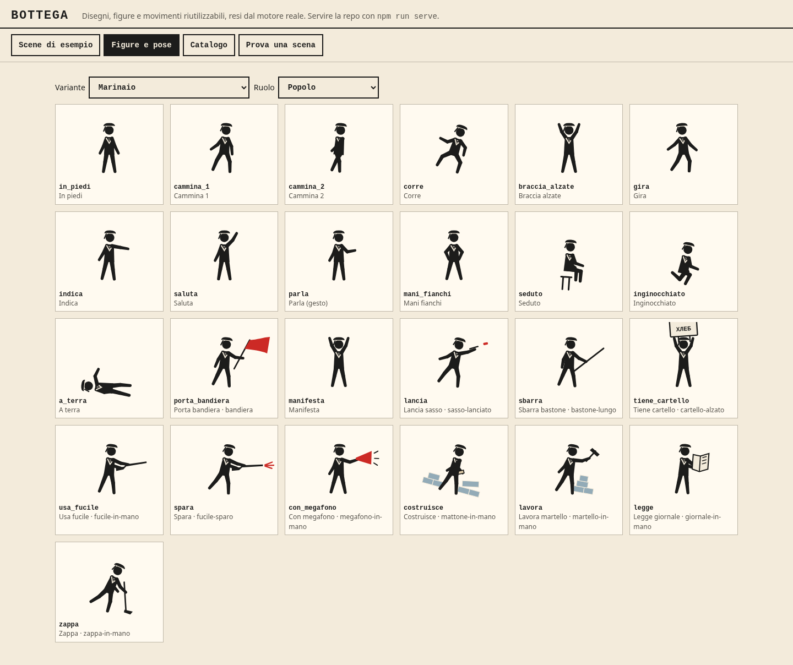
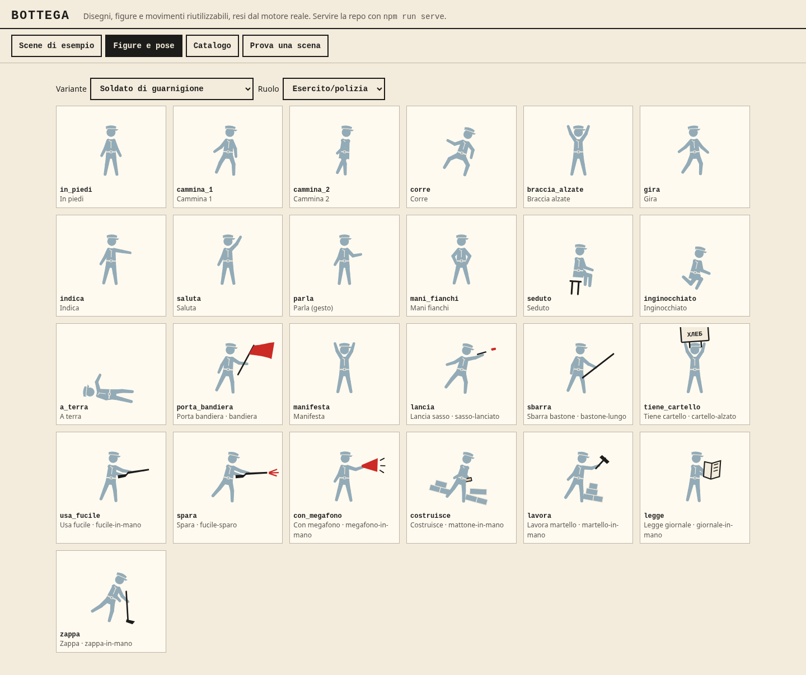
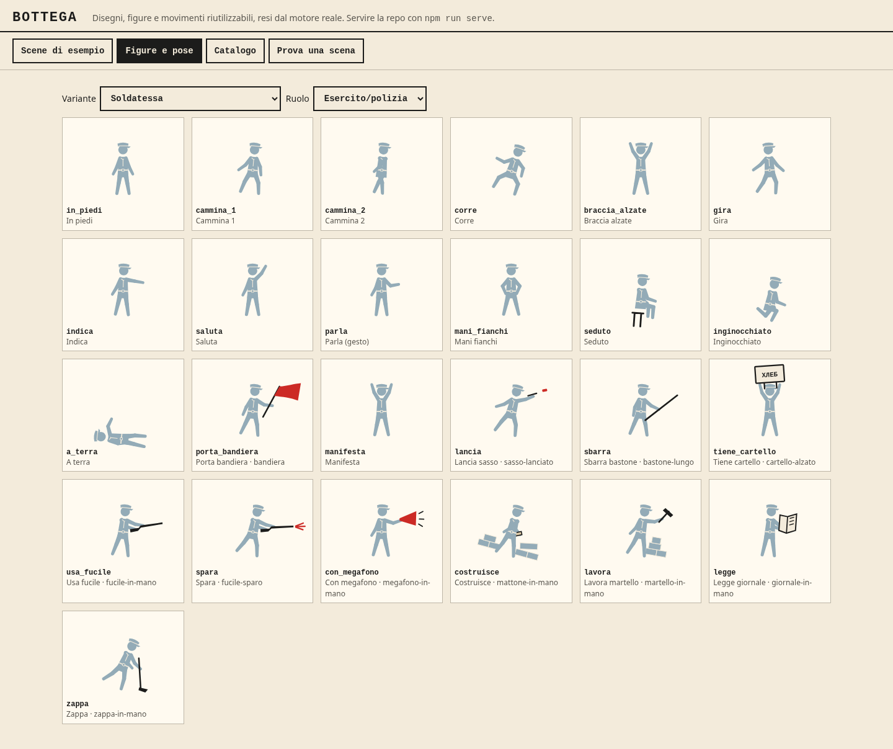
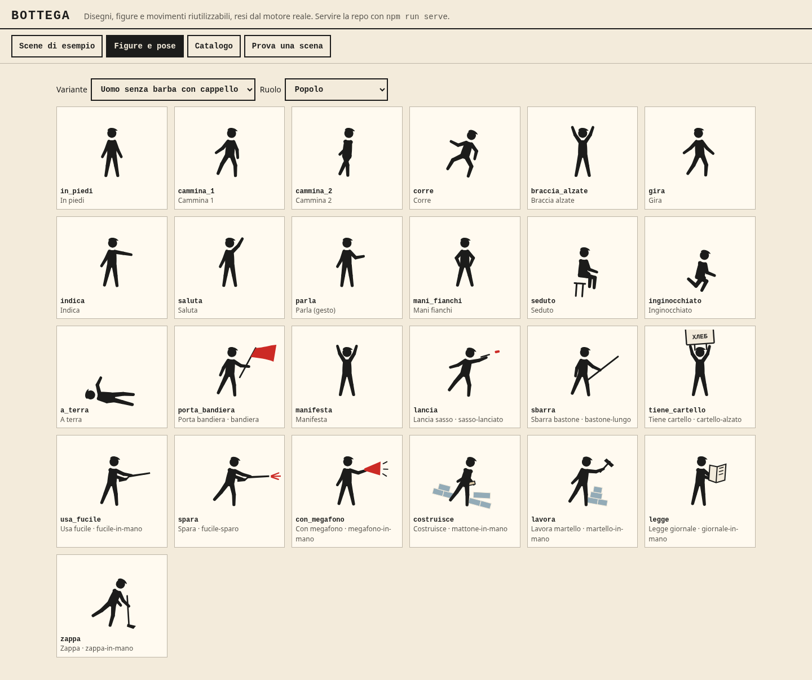
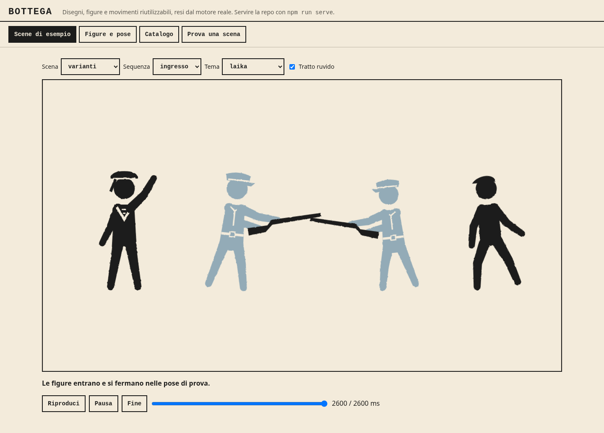

# Evidenze delle varianti per l'Atto II

Data: 23 ottobre 2026. Baseline: `2c5082975176b45034b143057b647f29795846a1`. Node 24.19.0; Playwright **1.58.2**, versione richiesta da `package.json`. Nessun cambio alle dipendenze dichiarate o agli originali in `prototypes/` e `references/`.

## Comandi e risultati locali

| Comando dalla radice della repo | Risultato |
|---|---|
| `npm test`, prima delle modifiche | **98/98 PASS**, [log](npm-test-prima.txt) |
| `npm test`, dopo le modifiche | **101/101 PASS**, [log](npm-test-finale.txt) |
| `npm run scena -- bottega/esempi/varianti.json` | **PASS**, 140 layer, 34 tracce, 2600 ms |
| `PLAYWRIGHT_BROWSERS_PATH=/tmp/laika-playwright npm run test:browser` | **PASS su Chromium**, suite completa, [log](browser-chromium.txt) |
| `PLAYWRIGHT_BROWSERS_PATH=/tmp/laika-playwright KIT_BROWSER=webkit npm run test:browser` | **Non avviato**, mancano librerie di sistema; [errore completo](browser-webkit.txt) |
| `git diff --check` | **PASS**, nessun errore |

Il fixture acquisito prima di modificare il generatore conserva esattamente l'output delle 13 varianti precedenti in 1300 combinazioni di posa e ruolo. Il controllo browser della bottega, eseguito anche separatamente, passa: **153 confronti con zero differenze**, incluse tutte le 13 varianti originali, e **11 scene** di esempio. [Risultati per confronto](bottega-equivalenza.json). Non sono state allentate le soglie del confronto originale. Nei log Node i simboli del reporter sono trascritti come `PASS`, `FAIL` e `INFO`; nomi, conteggi ed esiti sono quelli dell'esecuzione.

Preparazione effettivamente eseguita:

```sh
npm install --ignore-scripts --package-lock=false --cache /tmp/laika-npm-cache
PLAYWRIGHT_BROWSERS_PATH=/tmp/laika-playwright npx playwright install chromium webkit ffmpeg
python3 scripts/build-motion-preview.py
python3 scripts/build-motion-preview.py --rig
```

L'installazione ha scaricato i browser e FFmpeg. Le librerie mancanti per WebKit sono `libgtk-4.so.1`, `libgraphene-1.0.so.0`, `libharfbuzz-icu.so.0`, `libmanette-0.2.so.0`, `libhyphen.so.0`, `libwoff2dec.so.1.0.2` e `libGLESv2.so.2`. La matrice CI esistente installa le dipendenze di sistema e controlla entrambi i browser; l'esito locale di WebKit non viene dichiarato verde.

Tentativi di preparazione non conclusivi, prima dei risultati finali:

- il primissimo `npm test` nel sandbox ristretto ha segnalato `spawnSync python3 EPERM` in due test. Rieseguito prima delle modifiche tramite lo strumento con permesso rete, è passato senza cambi al codice: 98/98;
- il primo `npm install` non poteva scrivere la cache predefinita; l'opzione `--cache /tmp/laika-npm-cache` ha risolto;
- `CHROME_BIN=/usr/bin/chromium npm run test:browser` si è fermato per FFmpeg di Playwright assente;
- dopo il download dei browser, un tentativo Chromium si è fermato in `browser-motion.cjs` perché `dist/motion-study.html` non era stato generato. Eseguiti entrambi i generatori previsti dalla CI prima della suite finale.

## Screenshot della galleria reale

Acquisiti a 1440 px, tema `laika`, movimento ridotto. Le figure militari usano il ruolo `esercito`; marinaio e civile usano `popolo`. Nessuna alterazione del DOM o delle immagini dopo la cattura.

Comandi effettivamente eseguiti, in due terminali:

```sh
npm run serve
PLAYWRIGHT_BROWSERS_PATH=/tmp/laika-playwright node docs/evidence/figure-atto-ii/cattura.cjs
```

URL: `http://127.0.0.1:4173/bottega/galleria.html`. Lo [script di cattura](cattura.cjs) usa i selettori della galleria e salva questi file:

| Marinaio | Soldato di guarnigione |
|---|---|
|  |  |

| Soldatessa | Uomo senza barba con cappello |
|---|---|
|  |  |



Le bozze restano da sottoporre alla revisione visiva. Fonti, limiti iconografici e tre abiti solo proposti sono nella [scheda delle figure](../../FIGURE-ATTO-II.md).
